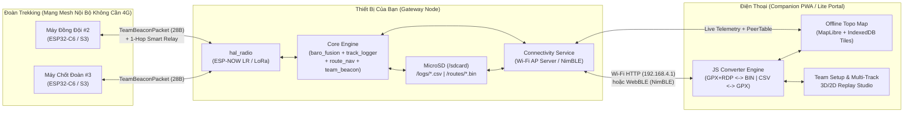

# Kế Hoạch Chi Tiết Companion Web App & Hệ Sinh Thái Ghép Đội — Outdoor GPS Tracker

Tài liệu này định nghĩa kiến trúc, tính năng và **Hợp đồng Giao tiếp (Protocol Contract)** giữa **Firmware Thiết Bị** ([PLAN.md](file:///home/antigravity/diembv/ESP32C6-Outdoor-Tracker/PLAN.md), [DOCS_MULTI_BOARD_PLAN.md](file:///home/antigravity/diembv/ESP32C6-Outdoor-Tracker/DOCS_MULTI_BOARD_PLAN.md)) và **Companion Web App / PWA** trên điện thoại (iOS / Android).

---

## 1. Triết Lý Thiết Kế: Mô Hình "Hai Mảnh Ghép Bổ Trợ" (Garmin + Garmin Explore)

Khi đi trekking/leo núi nhiều ngày (như Nhìu Cồ San, Kỳ Quan San, Putaleng), người dùng cần cả **sự gọn nhẹ, bền bỉ, tiết kiệm pin trên cổ tay/balo** lẫn **khả năng nhìn bao quát bản đồ địa hình, lập kế hoạch và quản lý đội nhóm trên màn hình lớn của điện thoại**:

| Tiêu chí | Thiết Bị Tracker (Firmware C/C++) | Companion Web App / PWA (Điện Thoại) |
|---|---|---|
| **Vai trò chính** | Thu thập GPS + Khí áp BMP580 liên tục, dẫn đường Breadcrumb tức thời, phát sóng ghép đội **ESP-NOW / LoRa** và báo động an toàn. | Lập kế hoạch cung đường, tải bản đồ địa hình Topo Offline, cài đặt đội nhóm, chuyển đổi file `.gpx` $\leftrightarrow$ `.bin`/`.csv`, và hiển thị cả đoàn lên bản đồ lớn. |
| **Môi trường hoạt động** | Bật 100% thời gian suốt chuyến đi (mưa, sương mù, đeo găng tay, 0% sóng điện thoại). | Chỉ rút điện thoại ra khi ở điểm xuất phát, tại ngã rẽ phức tạp, ở lán nghỉ, hoặc sau chuyến đi. |
| **Tài nguyên phần cứng** | Giới hạn chặt chẽ (512KB SRAM trên ESP32-C6 đến 8MB PSRAM trên ESP32-S3). | Tận dụng CPU mạnh, màn hình cảm ứng lớn và hàng GB bộ nhớ lưu trữ của điện thoại. |

> [!IMPORTANT]
> **Kiến trúc Kép (Dual-Mode Web UI) đảm bảo hoạt động trong mọi tình huống:**
> 1. **Embedded Lite Portal (`http://192.168.4.1` nhúng sẵn trong Flash ESP32, ~20 KB Gzip):** Dù đi giữa rừng sâu và điện thoại chưa từng mở trang web nào trước đó, chỉ cần bắt Wi-Fi của thiết bị là mở được ngay giao diện nạp file `.gpx` $\rightarrow$ `.bin`, tải log `.csv` $\rightarrow$ `.gpx` và đổi cấu hình nhóm (`team_id`, `callsign`).
> 2. **Full Companion PWA (Thư mục `webapp/` — Cài ra màn hình chính iOS/Android):** Có `Service Worker` + `IndexedDB` lưu trữ sẵn bản đồ địa hình **OpenTopoMap Offline**, biểu đồ độ cao tương tác, công cụ gắn mốc Waypoints và tính năng **Replay hành trình cả đoàn**.

---

## 2. Kiến Trúc Tổng Thể & Luồng Dữ Liệu



---

## 3. Bốn Phân Hệ Tính Năng Của Companion Web App

### Phân Hệ 1 — Trước Chuyến Đi: Route Studio & Ghép Đội Nhanh (Pre-Trek Preparation)
1. **Biên tập Lộ trình & Nén Nhị phân Trực tiếp trên Trình duyệt:**
   - Mở file `.gpx` bất kỳ (tải từ UpTrail, RideWithGPS, Wikiloc, AllTrails).
   - Hiển thị **Biểu đồ Độ cao (Elevation Profile)** kèm độ dốc (`% grade`) để nhận diện các đoạn dốc gắt.
   - Cho phép chấm chọn **Waypoints quan trọng** dọc đường (VD: *Điểm bắt đầu, Suối lấy nước, Thác Ong Chúa, Lán nghỉ 2400m, Ngã ba Bãi Dê, Đỉnh 2965m*).
   - Thuật toán **Ramer-Douglas-Peucker (RDP)** viết bằng TypeScript chạy ngay trên trình duyệt điện thoại, nén tuyến đường xuống định dạng nhị phân `.bin` tương thích 100% với [`RouteHeader`](file:///home/antigravity/diembv/ESP32C6-Outdoor-Tracker/src/route_nav.h#L25-L37) (thay thế hoàn toàn thao tác chạy [gpx_to_route.py](file:///home/antigravity/diembv/ESP32C6-Outdoor-Tracker/tools/gpx_to_route.py) trên máy tính).
2. **Tải Bản Đồ Địa Hình Offline Tự Động Theo Bounding Box (`Offline Tile Caching`):**
   - Dựa vào `min_lat, max_lat, min_lon, max_lon` của file GPX (cộng thêm vùng đệm an toàn `2 km`), ứng dụng tự động tải các ô bản đồ địa hình có đường đồng mức (**OpenTopoMap / Thunderforest Outdoors** từ mức zoom `12` đến `16`, chỉ tốn khoảng **5–15 MB** cho cả một ngọn núi như Nhìu Cồ San) và lưu vào `IndexedDB` trên điện thoại.
3. **Khởi Tạo Đội Trekking (Team Provisioning):**
   - Trưởng đoàn tạo phòng nhóm: sinh mã `team_id` (4 chữ số), cấu hình ngưỡng cảnh báo rớt đoàn (VD: `250m`), danh sách thành viên (`node_id 1..8`, `callsign` 6 ký tự như `LEADER`, `DIEM`, `PORTER`).
   - Đồng bộ cấu hình nhóm + file lộ trình `active.bin` xuống từng thiết bị ESP32 chỉ bằng 1 chạm qua Wi-Fi/BLE.

### Phân Hệ 2 — Trong Chuyến Đi: Bản Đồ Địa Hình Chiến Thuật & Cầu Nối Đồng Đội (In-Trek Bridge)
1. **Biến Thiết Bị ESP32 Thành Cầu Nối Định Vị Cho Điện Thoại:**
   - Khi gặp ngã ba rừng phức tạp hoặc có thành viên bị lạc/tách đoàn, người dùng mở Companion App trên điện thoại và kết nối vào thiết bị ESP32 của mình.
   - Thiết bị ESP32 truyền sang điện thoại:
     - Tọa độ GPS + Độ cao khí áp kế chuẩn xác (`baro_fusion`) của bản thân.
     - Toàn bộ danh sách đồng đội (`PeerTable`) mà thiết bị thu nhận được qua sóng **ESP-NOW Long-Range / LoRa**.
2. **Hiển Thị Cả Đoàn Trên Bản Đồ Địa Hình Đường Đồng Mức (Offline Topo Map):**
   - Điện thoại hiển thị nền bản đồ địa hình (có đường đồng mức độ cao, suối, đỉnh núi) đã lưu offline, vẽ đường lộ trình mục tiêu, vị trí của mình và **tất cả các thành viên trong đoàn** kèm khoảng cách, hướng và độ chênh cao độ $\Delta h$.
   - Hỗ trợ gửi lệnh nhanh từ điện thoại xuống thiết bị: *Đặt điểm Waypoint khẩn cấp tại vị trí hiện tại*, *Calib lại độ cao theo GPS*, hoặc *Kích hoạt/Hủy phát tín hiệu SOS*.

### Phân Hệ 3 — Tại Lán Nghỉ / Sau Chuyến Đi: Quản Lý Thẻ Nhớ & Xuất File GPX Chuẩn Quốc Tế
1. **Trình Quản Lý File MicroSD Không Dây (`Wireless SD Manager`):**
   - Xem dung lượng thẻ nhớ, danh sách các bản ghi trong `/sdcard/logs/*.csv` và các lộ trình trong `/sdcard/routes/*.bin`.
   - Hỗ trợ chọn nhiều lộ trình lưu sẵn trên thẻ (VD: `nhiu_co_san_up_ong_chua.bin`, `nhiu_co_san_down_bai_de.bin`, `bavi_summit.bin`) và bấm **"Kích hoạt lộ trình này"** mà không cần tháo thẻ nhớ.
2. **Trình Biên Dịch CSV $\rightarrow$ GPX Ngay Trên Điện Thoại:**
   - Tải file log nén `.csv` (`ts,lat,lon,alt` từ [`track_logger.cpp`](file:///home/antigravity/diembv/ESP32C6-Outdoor-Tracker/src/core/track_logger.cpp)) về điện thoại trong vài giây.
   - Chuyển đổi tức thời sang định dạng **GPX 1.1** chuẩn quốc tế (tương đương công cụ [csv_to_gpx.py](file:///home/antigravity/diembv/ESP32C6-Outdoor-Tracker/tools/csv_to_gpx.py)) kèm nút **Share File** trực tiếp sang ứng dụng **Strava**, **Garmin Connect**, **Relive** hoặc lưu vào tệp điện thoại.

### Phân Hệ 4 — Tổng Kết Hành Trình Đoàn: Multi-Track Replay & Analytics
1. **Ghép Track Cả Đoàn & Phát Lại Theo Thời Gian Thực (Synchronized Team Replay):**
   - Sau chuyến đi, các thành viên gửi file `.csv` / `.gpx` của mình vào Companion App.
   - Vì mọi thiết bị đều lấy mốc thời gian chuẩn **UTC Unix Epoch (`ts`)** từ vệ tinh GPS, ứng dụng tự động đồng bộ hóa trục thời gian và **chạy hoạt cảnh (Animated Replay)** các chấm màu đại diện cho từng thành viên leo từ chân núi lên đỉnh trên bản đồ.
2. **Thống Kê Chuyên Sâu Cho Dân Leo Núi:**
   - Tự động tách thời gian di chuyển thực tế (Moving Time) vs. thời gian dừng nghỉ (Stopped Time).
   - Tính tổng độ cao leo tích lũy (**Total Elevation Gain / Loss**) từ dữ liệu khí áp BMP580 siêu mượt.
   - Biểu đồ vận tốc leo thẳng đứng (**VAM — Vertical Ascent in Meters/hour**) theo từng chặng (Chân núi $\rightarrow$ Thác Ong Chúa $\rightarrow$ Lán nghỉ $\rightarrow$ Đỉnh).

---

## 4. Hợp Đồng Giao Tiếp Kỹ Thuật (Protocol Contract Giữa Firmware & Web/App)

Để Firmware và Web App phát triển độc lập mà luôn khớp nhau 100%, dưới đây là đặc tả giao thức chuẩn:

### 4.1. Định Dạng Nhị Phân Lộ Trình `.bin` (Tương Thích Ngược v1 & Mở Rộng Waypoints v2)
Giữ nguyên cấu trúc 96 bytes của [`RouteHeader`](file:///home/antigravity/diembv/ESP32C6-Outdoor-Tracker/src/route_nav.h#L25-L37) và tận dụng vùng `reserved[32]` để bổ sung danh sách **Waypoints** ở cuối file mà không làm hỏng bộ đọc v1 hiện tại:

```c
#pragma pack(push, 1)
typedef struct {
    char     magic[4];         // "ROUT"
    uint16_t version;          // 1 (cơ bản) hoặc 2 (có thêm Waypoints ở cuối file)
    uint16_t waypoint_count;   // Số lượng điểm mốc Waypoint (0 nếu version == 1)
    uint32_t point_count;      // Tổng số điểm RoutePoint (8 bytes/điểm)
    float    total_dist_km;    // Tổng chiều dài tuyến đường (km)
    float    min_lat;          // Bounds vĩ độ min
    float    max_lat;          // Bounds vĩ độ max
    float    min_lon;          // Bounds kinh độ min
    float    max_lon;          // Bounds kinh độ max
    char     name[32];         // Tên lộ trình (UTF-8 không dấu / ASCII, null-terminated)
    uint8_t  reserved[32];     // Dự phòng mở rộng
} RouteHeader;                 // Kích thước cố định: 96 bytes

// Ngay sau mảng RoutePoint[point_count] (mỗi điểm 8 bytes: float lat, float lon),
// nếu waypoint_count > 0 sẽ là mảng RouteWaypoint[waypoint_count]:
typedef struct {
    float    lat;              // Vĩ độ điểm mốc
    float    lon;              // Kinh độ điểm mốc
    int16_t  alt_m;            // Độ cao điểm mốc (m)
    uint8_t  icon_type;        // 0=Generic, 1=Summit(Đỉnh), 2=Camp(Lán), 3=Water(Suối/Thác), 4=Danger(Nguy hiểm)
    char     label[21];        // Tên điểm mốc (VD: "LAN NGHI 2400M", "THAC ONG CHUA")
} RouteWaypoint;               // Kích thước cố định: 32 bytes/waypoint
#pragma pack(pop)
```

### 4.2. Giao Thức REST API Khi Bật Wi-Fi Hotspot (`http://192.168.4.1`)

| Phương thức & Endpoint | Chức năng | Định dạng Payload / Phản hồi |
|---|---|---|
| `GET /` | Trả về trang **Embedded Lite Portal** (`index.html.gz` lưu trong PROGMEM). | `text/html; Content-Encoding: gzip` |
| `GET /api/status` | Trạng thái tổng quan của thiết bị: Board name, Pin (V, %), GPS fix, Độ cao Baro, SD free MB, Route đang mở, Trạng thái REC. | `application/json` |
| `GET /api/peers` | Danh sách đồng đội (`PeerTable`) nhận được qua ESP-NOW / LoRa kèm tuổi gói tin (`age_s`). | `application/json` |
| `GET /api/logs` | Liệt kê các file log `.csv` trong `/sdcard/logs/` kèm kích thước (bytes). | `application/json` |
| `GET /api/logs/download?name=...` | Stream trực tiếp nội dung file `.csv` từ thẻ nhớ về trình duyệt (có khóa `hal_display_lock` theo chunk 1KB trên C6). | `text/csv` |
| `DELETE /api/logs?name=...` | Xóa file log cũ trên thẻ nhớ sau khi đã đồng bộ xong. | `application/json` |
| `GET /api/routes` | Liệt kê các file lộ trình `.bin` trong `/sdcard/routes/` và file nào đang active. | `application/json` |
| `POST /api/routes/upload?name=...` | Upload file lộ trình `.bin` đã nén RDP từ điện thoại lên `/sdcard/routes/` và tự động kích hoạt. | `application/octet-stream` (Multipart/Raw) |
| `POST /api/routes/activate?name=...` | Chuyển đổi lộ trình đang dẫn đường sang một file `.bin` khác có sẵn trên thẻ. | `application/json` |
| `GET /api/team` & `POST /api/team` | Đọc / Lưu cấu hình ghép đội (`enabled`, `team_id`, `node_id`, `callsign`, `alert_dist_m`) vào NVS Flash. | `application/json` |

### 4.3. Giao Thức Bluetooth Low Energy (`NimBLE` GATT Profile)
Dành cho kết nối tốn ít điện trong lúc đang leo núi (Service UUID: `6E400001-B5A3-F393-E0A9-E50E24DCCA9E`):

1. **Characteristic `0x0002` — Live Telemetry (`READ | NOTIFY`, 1 Hz, 32 bytes):**
   - Gửi trực tiếp tọa độ `lat_e7`, `lon_e7`, `alt_dm`, `speed_cms`, `course_deg`, `sats`, `hdop_x10`, `bat_pct`, `flags` (đang ghi log, đã calib baro, đang bật team beacon).
2. **Characteristic `0x0003` — Team Peer Snapshot (`READ | NOTIFY`, 28 bytes/peer):**
   - Đẩy thông tin các đồng đội trong `PeerTable` lên bản đồ địa hình của điện thoại mỗi khi có gói ESP-NOW / LoRa mới.
3. **Characteristic `0x0004` — Remote Control & Config (`WRITE`):**
   - Nhận lệnh ngắn từ điện thoại:
     - `0x01`: Bật/Tắt ghi log CSV (`track_logger_toggle`).
     - `0x02`: Yêu cầu hiệu chuẩn lại độ cao Baro từ GPS (`baro_request_recalibration`).
     - `0x03`: Đổi chế độ thể thao (`Hiking` / `Cycling`).
     - `0x04`: Cập nhật cấu hình nhóm (`team_id`, `callsign`, bật/tắt `team_beacon`).
     - `0x05`: Bật/Tắt phát tín hiệu khẩn cấp `SOS`.

---

## 5. Công Nghệ Đề Xuất & Cấu Trúc Thư Mục `webapp/`

Để giao diện vừa chạy được trên đám mây (PWA Offline-First) vừa có bản rút gọn nhúng vừa vào bộ nhớ Flash của ESP32:

- **Ngôn ngữ & Build Tool:** `TypeScript` + `Vite` (khởi tạo cực nhanh, hỗ trợ đóng gói single-file hoặc PWA).
- **UI Framework:** `Preact` + `TailwindCSS` (runtime của Preact chỉ **3 KB**, nhỏ hơn React 10 lần nên có thể dùng chung component cho cả bản nhúng trên Flash ESP32 lẫn bản PWA đầy đủ!).
- **Engine Bản Đồ Offline:** `MapLibre GL JS` kết hợp `CacheStorage / IndexedDB` để lưu trữ các ô bản đồ địa hình đường đồng mức (`OpenTopoMap` / `OSM`).
- **Cấu trúc thư mục dự kiến:**
  ```text
  ESP32C6-Outdoor-Tracker/
  ├── webapp/
  │   ├── package.json
  │   ├── vite.config.ts               # Hỗ trợ build 2 đích: 'pwa' (đầy đủ) và 'embedded' (nén <25KB cho ESP32)
  │   ├── src/
  │   │   ├── core/
  │   │   │   ├── rdp_compiler.ts      # Thuật toán nén GPX -> .bin (Header 96B + Points + Waypoints)
  │   │   │   ├── csv_to_gpx.ts        # Bộ dịch log .csv -> .gpx chuẩn Strava/Garmin
  │   │   │   ├── device_client.ts     # Lớp giao tiếp thống nhất qua Wi-Fi HTTP & WebBLE
  │   │   │   └── offline_tiles.ts     # Trình tải và lưu bản đồ Topo Offline vào IndexedDB
  │   │   ├── components/
  │   │   │   ├── TopoMapView.tsx      # Bản đồ địa hình + hiển thị đồng đội Team Beacon
  │   │   │   ├── RouteStudio.tsx      # Mở GPX, xem biểu đồ độ cao, gắn Waypoints, nạp xuống mạch
  │   │   │   ├── SdLogManager.tsx     # Quản lý file thẻ nhớ & xuất GPX 1 chạm
  │   │   │   ├── TeamConfigPanel.tsx  # Cài đặt mã nhóm, tên thành viên, ngưỡng cảnh báo
  │   │   │   └── TeamReplayView.tsx   # Phát lại hành trình nhiều thành viên sau chuyến đi
  │   │   └── main.tsx
  │   └── scripts/
  │       └── gen_embedded_header.py   # Tự động nén bản build 'embedded' thành include/web_portal_gz.h
  ```

---

## 6. Lộ Trình Triển Khai Phần Web/App (4 Giai Đoạn Độc Lập)

- [ ] **Web Phase 1 — Bộ Công Cụ Lõi TypeScript & Embedded Lite Portal (`http://192.168.4.1`):**
  - Chuyển đổi 2 thuật toán Python ([gpx_to_route.py](file:///home/antigravity/diembv/ESP32C6-Outdoor-Tracker/tools/gpx_to_route.py) và [csv_to_gpx.py](file:///home/antigravity/diembv/ESP32C6-Outdoor-Tracker/tools/csv_to_gpx.py)) sang TypeScript (`rdp_compiler.ts`, `csv_to_gpx.ts`).
  - Xây dựng giao diện Lite Portal nhúng trong PROGMEM (`include/web_portal_gz.h`) kết hợp với module `wifi_sync.cpp` trên ESP32: quản lý thẻ nhớ, tải log CSV ra GPX, chọn file GPX trên điện thoại nén và nạp thẳng thành `/sdcard/routes/active.bin`.
- [ ] **Web Phase 2 — Route Studio & Bản Đồ Địa Hình Topo Offline (PWA):**
  - Tích hợp `MapLibre GL JS` và trình tải bản đồ địa hình đường đồng mức offline (`offline_tiles.ts`) theo khung bao (Bounding Box) của tuyến đường.
  - Thêm công cụ vẽ biểu đồ độ cao và gắn mốc **Waypoints** (`RouteHeader` v2).
- [ ] **Web Phase 3 — Cầu Nối Ghép Đội Thời Gian Thực (Team Beacon Live Bridge):**
  - Kết nối với tầng `team_beacon` (Milestone 9) qua Wi-Fi / WebBLE để hiển thị vị trí cả đoàn, độ chênh cao độ $\Delta h$ và cảnh báo SOS trực tiếp trên nền bản đồ địa hình của điện thoại.
  - Giao diện cấu hình nhóm 1 chạm (`team_id`, `callsign`, ngưỡng khoảng cách).
- [ ] **Web Phase 4 — Multi-Track Team Replay & Strava Export:**
  - Ghép nhiều file log `.csv`/`.gpx` của các thành viên trong đoàn để chạy mô phỏng lại toàn bộ hành trình leo núi theo trục thời gian thực và thống kê chuyên sâu (VAM, Elevation Gain, Moving Time).
