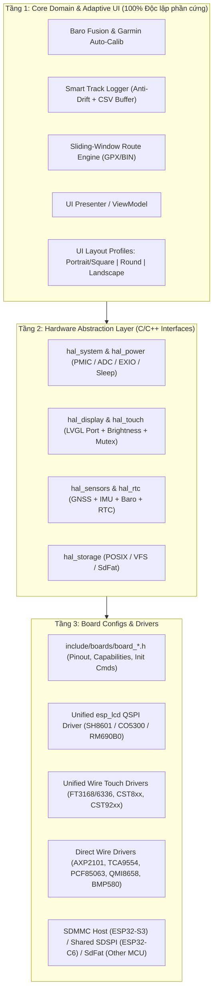

# Kế Hoạch Nâng Cấp Đa Màn Hình & Đa MCU — Outdoor GPS Tracker

Tài liệu này định nghĩa kiến trúc nâng cấp từ codebase đơn bo mạch hiện tại ([main.cpp](file:///home/antigravity/diembv/ESP32C6-Outdoor-Tracker/src/main.cpp), [ui_dashboard.cpp](file:///home/antigravity/diembv/ESP32C6-Outdoor-Tracker/src/ui_dashboard.cpp), [lcd_bsp.c](file:///home/antigravity/diembv/ESP32C6-Outdoor-Tracker/lib/WaveshareBSP/lcd_bsp.c), [sd_logger.cpp](file:///home/antigravity/diembv/ESP32C6-Outdoor-Tracker/src/sd_logger.cpp)) sang kiến trúc **Multi-Board HAL + Adaptive UI**, trước mắt hỗ trợ đầy đủ **6 bo mạch Waveshare AMOLED** (1 hiện tại + 5 bo mạch mới) và sẵn sàng mở rộng sang các MCU khác (RP2040, STM32, nRF52).

---

## 1. Ma Trận Phần Cứng 6 Bo Mạch Mục Tiêu (Giai Đoạn Đầu)

| Mã Board (Waveshare) | MCU & Bộ nhớ | Màn hình & Hình dáng | Driver QSPI | Touch I2C | Nguồn / IO Phụ / RTC | Thẻ nhớ TF |
|---|---|---|---|---|---|---|
| **C6-AMOLED-1.64** *(Hiện tại)* | ESP32-C6 (160MHz), 512KB SRAM, **0 PSRAM**, 16MB Flash | 1.64" **280×456** (Dọc - Portrait) | **SH8601** (`x_gap=0x14`) | **FT3168** (`0x38`) | ADC `GPIO0` đo pin, không PMIC, không RTC rời | **SDSPI** chung `SPI2` với màn hình |
| **S3-AMOLED-1.75C** | ESP32-S3R8 (240MHz), **8MB PSRAM**, 16MB Flash | 1.75" **466×466** (**Tròn - Round**) | **CO5300** | **CST9217** (`0x5A`) | **AXP2101** PMIC + **TCA9554** EXIO + **PCF85063** RTC *(bản `-G` có GPS LC76G)* | **SDMMC** / SPI riêng |
| **S3-AMOLED-1.8** | ESP32-S3R8 (240MHz), **8MB PSRAM**, 16MB Flash | 1.8" **368×448** (Dọc - Portrait) | **SH8601** (V1) / **CO5300** (V2) | **FT3168** (V1) / **CST820** (V2) | **AXP2101** PMIC + **TCA9554** EXIO + **PCF85063** RTC | **SDMMC** 1-bit / SPI |
| **S3-AMOLED-2.06** *(Watch)* | ESP32-S3R8 (240MHz), **8MB PSRAM**, **32MB Flash** | 2.06" **410×502** (Dọc - Watch) | **CO5300** (`x_gap=22`) | **FT3168** (`0x38`) | **AXP2101** PMIC + **PCF85063** RTC | **SDMMC** |
| **S3-AMOLED-2.16** | ESP32-S3R8 (240MHz), **8MB PSRAM**, 16MB Flash | 2.16" **480×480** (**Vuông - Square**) | **CO5300** | **CST9220** (`0x5A`) | **AXP2101** PMIC + **PCF85063** RTC | **SDMMC** / SPI |
| **S3-AMOLED-2.41** | ESP32-S3R8 (240MHz), **8MB PSRAM**, 16MB Flash | 2.41" **600×450** (**Ngang - Landscape**) | **RM690B0** | **FT6336** (`0x38`) | **TCA9554** (`EXIO1` = `AMOLED_EN`) + **PCF85063** RTC + mạch sạc | **SDMMC** / SPI |

> [!IMPORTANT]
> Cả 6 bo mạch đều tích hợp sẵn IMU **QMI8658** trên bus I2C nội bộ. Riêng cảm biến áp suất **BMP580** và module GPS ngoài (**ATGM336H**, trừ bản `1.75-G` có sẵn `LC76G`) kết nối qua header mở rộng UART/I2C, do đó tầng cảm biến phải hoạt động theo cơ chế **Graceful Degradation** (tự động nhận diện khi cắm vào và không treo/lỗi khi chạy độc lập không có sensor rời).

---

## 2. Kiến Trúc Phân Tầng Mới (3-Layer Architecture)



### Các nguyên tắc thiết kế cốt lõi

1. **Một chủ sở hữu I2C duy nhất (`Wire` + Mutex)**:
   Giữ nguyên bài học thực chiến từ [main.cpp](file:///home/antigravity/diembv/ESP32C6-Outdoor-Tracker/src/main.cpp#L80-L86): **tuyệt đối không trộn lẫn thư viện dùng `driver_ng` (`i2c_master`) với `Wire`**. Toàn bộ chip I2C phụ trợ trên 5 bo S3 (`AXP2101`, `TCA9554`, `PCF85063`, `FT3168/FT6336`, `CST820`, `CST9217/9220`, `QMI8658`) đều giao tiếp qua một lớp `hal_i2c` dùng `Wire` được bảo vệ bởi Mutex.
2. **Tận dụng Unified QSPI `esp_lcd` thay vì ép qua `LovyanGFX`**:
   Driver [esp_lcd_sh8601.c](file:///home/antigravity/diembv/ESP32C6-Outdoor-Tracker/lib/WaveshareBSP/esp_lcd_sh8601.c) hiện có sử dụng chuẩn QSPI opcode `0x02` (Command) và `0x32` (Quad Pixel Write), vốn tương thích trực tiếp với cả **SH8601**, **CO5300**, và **RM690B0** khi truyền đúng bảng `init_cmds[]`, `x_gap`/`y_gap` và callback làm tròn tọa độ chẵn (`rounder_cb` chia hết cho 2). Với MCU không phải ESP32 trong tương lai, chỉ cần viết thêm 1 file `hal_display_arduinogfx.cpp` thực thi cùng interface `hal_display.h`.
3. **Khóa Bus có điều kiện (`BOARD_SD_SHARES_DISPLAY_BUS`)**:
   Trên `ESP32-C6-1.64`, thẻ nhớ dùng chung `SPI2_HOST` với màn hình nên `hal_storage` tự động gọi `hal_display_lock()` khi flush sector. Trên 5 bo `ESP32-S3`, thẻ nhớ dùng `SDMMC` độc lập nên không cần khóa UI, loại bỏ hoàn toàn độ trễ khung hình khi ghi log.
4. **Cấp phát bộ nhớ thích ứng (`PSRAM-Aware`)**:
   - Không có PSRAM (`ESP32-C6`): LVGL dùng 2 DMA buffer nhỏ trong SRAM (`W × H/8`), bật bộ font vừa phải (`12, 14, 20, 28, 32`).
   - Có 8MB PSRAM (`ESP32-S3`): Cấp phát DMA bounce buffer tối ưu kết hợp PSRAM, bật thêm font lớn (`Montserrat 36, 48`) cho màn phân giải cao (`466×466`, `480×480`, `600×450`).

---

## 3. Chiến Lược Giao Diện Đa Hình Thái (Adaptive UI Profiles)

Vì 6 màn hình trải dài trên **4 kiểu hình học khác nhau**, việc chỉ co giãn tọa độ theo `%` sẽ làm mất góc trên màn **Tròn 466×466** và bố cục xấu trên màn **Ngang 600×450**. Giao diện sẽ được tách thành **2 lớp**:

1. **`ui_viewmodel.cpp` (Dùng chung 100%)**: Nhận `SensorSnapshot` và `RouteNavStatus`, định dạng toàn bộ chuỗi hiển thị (`speedStr`, `coordStr`, `xteStr`, `batStr`...), màu cảnh báo và sự kiện nút bấm (`onToggleLog`, `onCalibAlt`, `onChangeMode`, `onCycleZoom`).
2. **`ui_layout_*.cpp` (3 Layout Profiles tự động chọn theo cấu hình board)**:

| Layout Profile | Áp dụng cho Board | Đặc điểm bố cục (LVGL Flex/Grid) |
|---|---|---|
| **`UI_PROFILE_RECT_PORTRAIT`** | `C6-1.64` (280×456)<br>`S3-1.8` (368×448)<br>`S3-2.06` (410×502)<br>`S3-2.16` (480×480) | Giữ cấu trúc `lv_tileview` 3 trang ngang như hiện tại nhưng chuyển toàn bộ `lv_obj_set_pos(x,y)` sang **Flex Column (`LV_FLEX_FLOW_COLUMN`)** + padding tỷ lệ. Bán kính bản đồ tự tính `r_px = min(map_w, map_h) * 0.42f`. Tự chọn cỡ font theo chiều ngang màn hình (`<320px` vs `>=360px`). |
| **`UI_PROFILE_ROUND`** | `S3-1.75C` (466×466) | Tối ưu riêng cho mặt đồng hồ tròn: áp dụng **Circular Safe-Area Inset** (căn giữa `LV_ALIGN_TOP_MID` và `LV_ALIGN_BOTTOM_MID`, thu hẹp chiều ngang header/footer còn `~65%` đường kính để không chạm viền cắt tròn). Trang Bản đồ biến toàn bộ màn tròn 466×466 thành mặt Radar định vị có vòng la bàn sát viền cực kỳ tự nhiên. |
| **`UI_PROFILE_LANDSCAPE`** | `S3-2.41` (600×450) | Bố cục kiểu **Bike Computer (Garmin Edge ngang)**: Trang chính/điều hướng có thể hiển thị **Split-View 2 cột** (Cột trái `340×450`: Bản đồ lộ trình; Cột phải `260×450`: Tốc độ lớn, Cự ly còn lại, Độ cao Baro, Pin & Giờ), trang phụ cho Cài đặt & Ghi Log. |

---

## 4. Cấu Trúc Thư Mục Đề Xuất

```text
ESP32C6-Outdoor-Tracker/
├── platformio.ini                      # Định nghĩa [env:...] cho từng board
├── include/
│   ├── lv_conf.h                       # Cấu hình LVGL động theo macro PSRAM / Resolution
│   ├── app_types.h                     # Struct SensorSnapshot, GpsData, BaroData, ActivityMode...
│   ├── boards/
│   │   ├── board_select.h              # Router nạp đúng file board theo build flag
│   │   ├── board_ws_c6_amoled_164.h    # Waveshare ESP32-C6 1.64" (280x456)
│   │   ├── board_ws_s3_amoled_175c.h   # Waveshare ESP32-S3 1.75C" Round (466x466)
│   │   ├── board_ws_s3_amoled_180.h    # Waveshare ESP32-S3 1.8" (368x448, V1 & V2 auto-detect)
│   │   ├── board_ws_s3_amoled_206.h    # Waveshare ESP32-S3 2.06" Watch (410x502)
│   │   ├── board_ws_s3_amoled_216.h    # Waveshare ESP32-S3 2.16" Square (480x480)
│   │   └── board_ws_s3_amoled_241.h    # Waveshare ESP32-S3 2.41" Landscape (600x450)
│   └── hal/
│       ├── hal_i2c.h                   # Thread-safe Wire wrapper + Bus scanner
│       ├── hal_power.h                 # Init nguồn (AXP2101 / TCA9554 EXIO / ADC Battery / Wakeup)
│       ├── hal_display.h               # Display init, brightness, sleep/wake, LVGL lock/unlock
│       ├── hal_touch.h                 # Touch read interface (FT3168/6336, CST8xx, CST92xx)
│       ├── hal_sensors.h               # IMU (QMI8658), Baro (BMP580), GNSS UART, RTC (PCF85063)
│       └── hal_storage.h               # Mount SD (SDSPI / SDMMC / SdFat) + File IO
├── src/
│   ├── main.cpp                        # App orchestrator gọn nhẹ (~150 dòng), không chứa mã thanh ghi
│   ├── core/
│   │   ├── baro_fusion.cpp / .h        # Thuật toán Garmin P0 Lock + 15p Drift Compensator
│   │   ├── track_logger.cpp / .h       # Thuật toán Smart CSV Logging + Anti-drift + Sport Profiles
│   │   └── route_nav.cpp / .h          # Sliding Window GPX/BIN + Dynamic Screen Projection
│   ├── hal/
│   │   ├── common/                     # Driver I2C dùng chung: qmi8658, bmp580, pcf85063, tca9554, axp2101
│   │   ├── touch/                      # touch_focaltech.cpp, touch_cst8xx.cpp, touch_cst92xx.cpp
│   │   └── esp32/                      # hal_display_qspi.cpp, hal_storage_esp32.cpp, hal_system_esp32.cpp
│   └── ui/
│       ├── ui_dashboard.cpp / .h       # Entry point UI + điều phối cập nhật
│       ├── ui_viewmodel.cpp / .h       # Format dữ liệu & xử lý sự kiện dùng chung
│       ├── ui_theme.cpp / .h           # Bảng màu AMOLED & bộ chọn Font theo kích thước màn
│       ├── layout_portrait.cpp         # Layout cho 1.64", 1.8", 2.06", 2.16"
│       ├── layout_round.cpp            # Layout tròn cho 1.75C"
│       └── layout_landscape.cpp        # Layout ngang 2 cột cho 2.41"
└── tools/
    ├── csv_to_gpx.py
    └── gpx_to_route.py
```

---

## 5. Lộ Trình Triển Khai Chi Tiết (5 Giai Đoạn An Toàn)

> [!WARNING]
> Quy tắc vàng khi nâng cấp: **Không đập đi xây lại một lần**. Kết thúc mỗi Phase, môi trường `esp32c6_tracker` hiện tại phải biên dịch thành công (`pio run -e esp32c6_tracker`) và giữ nguyên 100% hành vi thực tế đã ổn định.

### Phase 1 — Tách Core Domain & Chuẩn Hóa Board Descriptor (0% rủi ro phần cứng)
- **Mục tiêu:** Đưa [main.cpp](file:///home/antigravity/diembv/ESP32C6-Outdoor-Tracker/src/main.cpp) từ 742 dòng về ~150 dòng điều phối sạch sẽ; tách toàn bộ thuật toán lõi sang `src/core/`.
- **Công việc cụ thể:**
  1. Tạo `include/app_types.h` chứa các struct dữ liệu độc lập khỏi LVGL.
  2. Tách thuật toán hiệu chuẩn áp suất khí áp kế 2 tầng từ [main.cpp](file:///home/antigravity/diembv/ESP32C6-Outdoor-Tracker/src/main.cpp#L308-L406) sang `src/core/baro_fusion.cpp`.
  3. Tách logic Smart CSV Logging + Anti-drift từ [sd_logger.cpp](file:///home/antigravity/diembv/ESP32C6-Outdoor-Tracker/src/sd_logger.cpp) sang `src/core/track_logger.cpp`, gọi qua `hal_storage`.
  4. Tạo `include/boards/board_ws_c6_amoled_164.h` và `board_select.h`.
- **Kiểm chứng:** Build `esp32c6_tracker` xanh 100%, dung lượng RAM/Flash tương đương bản cũ.

### Phase 2 — Xây Dựng Tầng Nguồn, I2C Phụ Trợ & RTC (`hal_power`, `hal_sensors`)
- **Mục tiêu:** Giải quyết sự khác biệt lớn nhất giữa dòng C6 và dòng S3 AMOLED của Waveshare.
- **Công việc cụ thể:**
  1. Viết `hal_i2c`: Quản lý `Wire` duy nhất kèm Mutex bảo vệ đa luồng.
  2. Viết driver nhẹ qua `Wire` cho:
     - **TCA9554 (`0x20`)**: Điều khiển chân mở rộng `EXIO` (cấp nguồn `AMOLED_EN` cho màn 2.41", kéo chân `LCD_RST` / `TP_RST` trên 1.75C & 1.8").
     - **AXP2101 (`0x34`)**: Bật các đường nguồn LDO cho màn hình/cảm ứng/thẻ nhớ, đọc điện áp pin (mV), phần trăm pin (%) và trạng thái đang sạc USB cho 1.75C, 1.8, 2.06, 2.16 (thay cho ADC GPIO0 của C6).
     - **PCF85063 (`0x51`)**: Khởi tạo thời gian hệ thống ngay khi boot từ RTC phần cứng trên 5 bo S3; tự động cập nhật lại giờ chuẩn từ GPS vào PCF85063 khi có sóng vệ tinh.
  3. Chuyển QMI8658, BMP580 và TinyGPSPlus UART vào `hal_sensors`.

### Phase 3 — Hợp Nhất Driver QSPI AMOLED, Đa Chip Cảm Ứng & SDMMC (`hal_display`, `hal_storage`)
- **Mục tiêu:** Chạy được màn hình, cảm ứng và thẻ nhớ trên tất cả 6 bo mạch.
- **Công việc cụ thể:**
  1. Nâng cấp [esp_lcd_sh8601.c](file:///home/antigravity/diembv/ESP32C6-Outdoor-Tracker/lib/WaveshareBSP/esp_lcd_sh8601.c) và [lcd_bsp.c](file:///home/antigravity/diembv/ESP32C6-Outdoor-Tracker/lib/WaveshareBSP/lcd_bsp.c) thành `src/hal/esp32/hal_display_qspi.cpp`:
     - Hỗ trợ bảng `init_cmds[]` riêng cho **SH8601**, **CO5300**, và **RM690B0**.
     - Đọc cấu hình `x_gap`, `y_gap`, `swap_xy`, `mirror_x/y` từ `board_*.h` thay vì cộng cứng `+ 0x14`.
     - Giữ `rounder_cb` làm tròn tọa độ chẵn `(x1 & ~1)` và `(x2 | 1)` bắt buộc cho mọi panel QSPI AMOLED.
     - Tự động cấu hình kích thước LVGL draw buffer theo cờ `BOARD_HAS_PSRAM`.
  2. Bổ sung 3 module cảm ứng gọn nhẹ trong `src/hal/touch/`:
     - `touch_focaltech.cpp` (`FT3168`, `FT6336` @ `0x38`).
     - `touch_cst8xx.cpp` (`CST816`, `CST820` @ `0x15` cho S3-1.8 V2).
     - `touch_cst92xx.cpp` (`CST9217`, `CST9220` @ `0x5A` cho S3-1.75C & S3-2.16).
     - Hỗ trợ **Auto-Detect V1/V2** cho bo `ESP32-S3-Touch-AMOLED-1.8` ngay lúc boot (dò địa chỉ I2C `0x38` vs `0x15`).
  3. Nâng cấp `hal_storage`: Hỗ trợ song song 2 chế độ `STORAGE_MODE_SDSPI` (cho C6-1.64) và `STORAGE_MODE_SDMMC_1BIT` (cho các bo S3).

### Phase 4 — Thiết Kế Lại Adaptive UI Cho 4 Hình Thái Màn Hình
- **Mục tiêu:** Hiển thị sắc nét, cân đối, không cắt góc và không vỡ chữ trên mọi độ phân giải từ `280×456` tới `600×450`.
- **Công việc cụ thể:**
  1. Sửa [`route_nav_project_to_screen`](file:///home/antigravity/diembv/ESP32C6-Outdoor-Tracker/src/route_nav.cpp#L323-L350) nhận thêm tham số `viewport_radius_px` động thay vì fix cứng `110.0f` px.
  2. Tách `ui_viewmodel.cpp` xử lý toàn bộ logic format dữ liệu và hộp thoại thông báo.
  3. Xây dựng 3 layout builders:
     - `layout_portrait.cpp`: Dùng LVGL Flex cho `280×456`, `368×448`, `410×502`, `480×480` kèm bộ chọn font tự động (`ui_theme`).
     - `layout_round.cpp`: Thiết kế đồng tâm cho màn tròn `466×466` (`1.75C`).
     - `layout_landscape.cpp`: Thiết kế 2 cột ngang cho màn `600×450` (`2.41`).

### Phase 5 — Cấu Hình Multi-Env `platformio.ini`, Kiểm Thử & Sẵn Sàng Mở Rộng MCU Khác
- **Mục tiêu:** Đóng gói hoàn chỉnh các môi trường build chỉ bằng 1 lệnh chọn board.
- **Công việc cụ thể:**
  1. Tổ chức lại [platformio.ini](file:///home/antigravity/diembv/ESP32C6-Outdoor-Tracker/platformio.ini) với `[env_common_esp32c6]` và `[env_common_esp32s3_psram]` (bật `-DBOARD_HAS_PSRAM`, `qio_opi` cho 8MB Octal PSRAM trên S3R8, phân vùng `16MB` / `32MB`).
  2. Khai báo 6 môi trường build tường minh:
     - `[env:ws_c6_amoled_164]`
     - `[env:ws_s3_amoled_175c]`
     - `[env:ws_s3_amoled_180]`
     - `[env:ws_s3_amoled_206]`
     - `[env:ws_s3_amoled_216]`
     - `[env:ws_s3_amoled_241]`
  3. Biên dịch kiểm tra (Compile Matrix) toàn bộ 6 môi trường để đảm bảo 0 lỗi biên dịch/liên kết trước khi nạp thử nghiệm lên bo thực tế.
  4. Chuẩn hóa tài liệu hướng dẫn thêm một bo mạch hoặc MCU mới (ví dụ RP2040 / nRF52840 dùng `SdFat` + `Arduino_GFX`) chỉ trong 2 bước: tạo `board_xxx.h` và chọn HAL backend.
