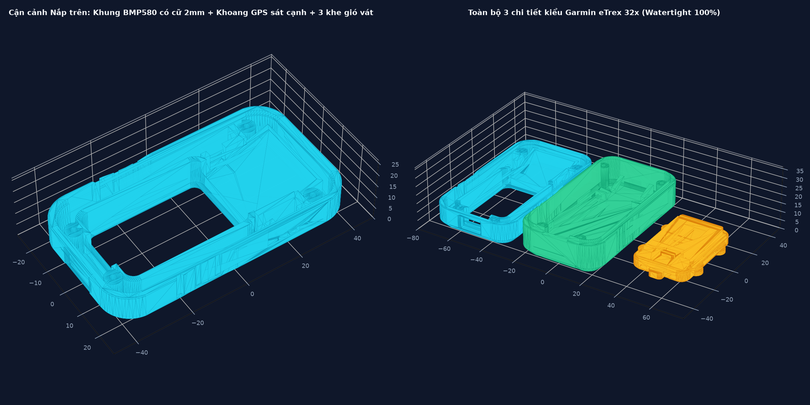

# 3D Enclosure / Case — ESP32-C6 Outdoor GPS Tracker
> **Phiên bản:** Garmin eTrex 32x Compact Edition (86.6 × 47.6 mm)



Thư mục chứa toàn bộ mã nguồn thiết kế và các tệp mô hình 3D in ấn cho vỏ thiết bị Tracker ngoài trời (ESP32-C6 Outdoor Tracker).

---

## 1. Cấu Trúc Thư Mục

```text
hardware/case/
├── cad/
│   ├── esp32c6_outdoor_tracker_case.scad   # File mô hình CAD gốc (OpenSCAD)
│   └── generate_stl.py                    # Script Python tự động sinh file STL (Manifold3D/Trimesh)
├── stl/
│   ├── tracker_top_cover.stl              # Nắp trên (chứa viền màn hình AMOLED 1.64" & gờ phím)
│   ├── tracker_bottom_shell.stl           # Thân dưới (khoang BMP580, ATGM336H GPS, Anten ceramic, pin Li-Po)
│   ├── tracker_bike_mount_base.stl        # Ngàm gắn xe đạp thao tác nhanh (Quick-Release Bike Mount)
│   └── tracker_full_print_plate.stl       # Bàn in tổng hợp (chứa cả 3 chi tiết để in 1 lần)
├── preview_3d_case.png                    # Ảnh phối cảnh 3D thiết kế vỏ
└── README.md                              # Hướng dẫn chi tiết
```

---

## 2. Đặc Điểm Thiết Kế Cơ Khí

1. **Kiểu dáng công thái học (Garmin eTrex 32x Style):**
   * Vát cạnh 45° sâu dọc thân giúp cầm nắm chắc chắn, chống trơn trượt khi đeo găng tay.
   * 3 rãnh gân ngang tăng độ bám.
   * 3 khe thoát khí đo áp suất khí quyển (barometric vent slits) vát 45° cho cảm biến BMP580, chống đọng nước giọt.
2. **Khoang bố trí linh kiện bên trong:**
   * **Cữ cảm biến áp suất BMP580:** Khoang chữ U chắc chắn, cữ cách vách ngoài 2.0mm giúp đón luồng khí tối ưu và bảo vệ cảm biến.
   * **Khoang GPS ATGM336H:** Vách giữ dày 2.0mm áp sát vách đối diện.
   * **Giá đỡ anten gốm GPS (Ceramic Antenna 25×25×4mm):** Thiết kế nghiêng 20° hướng lên trời giúp tối đa độ nhạy bắt sóng vệ tinh khi gắn nghiêng trên ghi-đông xe đạp hoặc cầm tay.
   * **Khoang pin:** Tối ưu cho pin Li-Po dẹt và cọc bắt vít đồng M2/M2.5.
3. **Ngàm gắn ghi-đông xe đạp (Quick-Release Bike Mount):**
   * Tương thích ngàm cài tiêu chuẩn hoặc dây thít cố định chắc chắn khi di chuyển trên địa hình gồ ghề.

---

## 3. Khuyến Nghị Cài Đặt In 3D

* **Vật liệu khuyên dùng:**
  * **PETG** hoặc **ABS/ASA**: Bắt buộc cho thiết bị dùng ngoài trời, chịu nắng nóng và chống tia UV (không nên dùng PLA thông thường vì dễ mềm/cong vênh khi để ngoài nắng).
* **Độ dày lớp in (Layer Height):** 0.16mm – 0.20mm (khuyên dùng 0.16mm cho ren và khớp ngàm mượt mà).
* **Độ dày thành (Perimeters / Wall loops):** 3 – 4 lớp.
* **Mật độ điền (Infill):** 25% – 40% (dạng Gyroid hoặc Grid).
* **Lớp đệm chống nước:** Có thể quét một lớp silicon mỏng hoặc dùng gioăng cao su non tại đường viền ghép giữa `top_cover` và `bottom_shell`.
